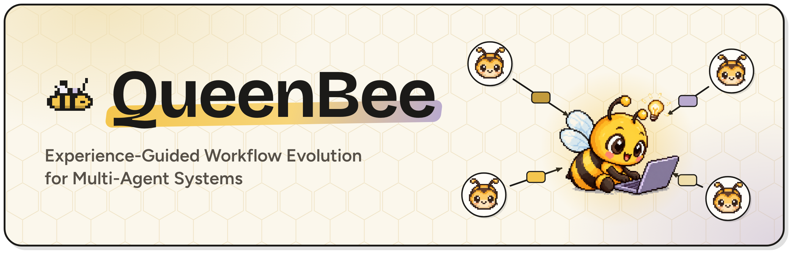
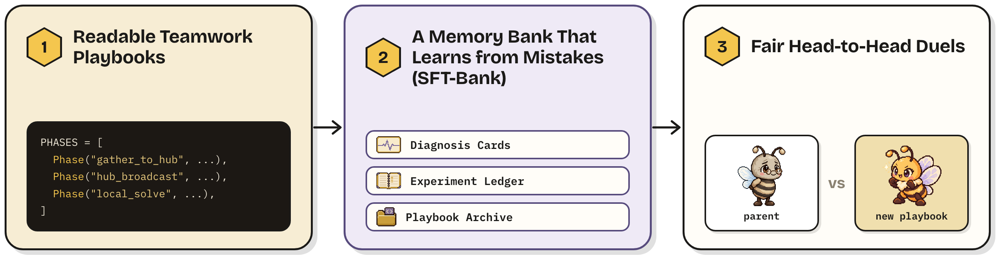
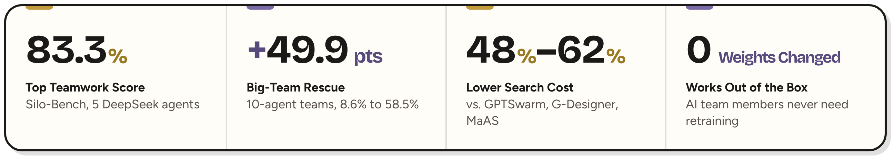
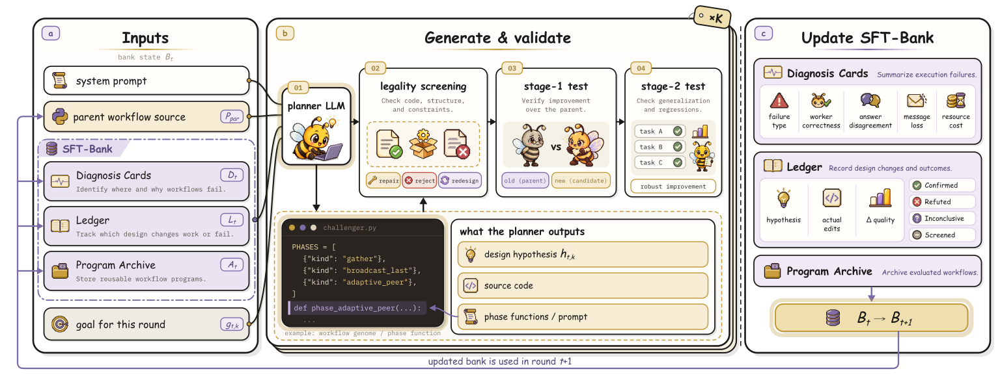
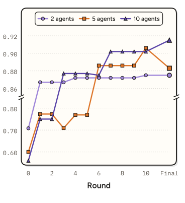

<p align="center">
  
</p>

# QueenBee: Experience-Guided Workflow Evolution for Multi-Agent Systems

<p align="center">
  <b><a href="#try-queenbee-in-2-minutes">Quickstart</a></b> ·
  <b><a href="#results-at-a-glance">Results at a Glance</a></b> ·
  <b><a href="#reproduce-the-paper">Reproduce the Paper</a></b>
</p>

**QueenBee** is an open-source framework that teaches a team of AI models how to work together better—without retraining any of the AI models themselves.

When multiple AI agents collaborate on a complex problem (where each agent only sees part of the puzzle), their success depends heavily on **how they organize their communication**: who sends information to whom, in what order, and with what instructions. Instead of relying on rigid, hand-crafted rules (like a relay chain or a noisy group chat) or memory-free trial-and-error, QueenBee evolves the team's **collaboration playbook** over multiple rounds while building a permanent **Teamwork Memory Bank (`SFT-Bank`)**:

1. **Readable Teamwork Playbooks:** Every workflow is written as a short, readable Python schedule (`PHASES`) that controls both *communication routes* (who talks to whom) and *work rules* (how to preserve and combine facts).
2. **A Memory Bank That Learns from Mistakes (`SFT-Bank`):** After every test, QueenBee records *why* a team failed (**Diagnosis Cards**), tracks which design ideas worked or flopped (**Experiment Ledger**), and saves a library of strong past playbooks (**Playbook Archive**).
3. **Fair Head-to-Head Duels:** New playbooks are checked for free in a sandbox before spending any AI tokens, then tested head-to-head against their parent playbook on the exact same tasks.

<p align="center">
  
</p>

---

## Try QueenBee in 2 Minutes

You can try QueenBee on your laptop **completely offline and for free** (no GPU and no paid API keys required) using our built-in simulated AI mode (`--fake`), or connect it to any OpenAI-compatible AI model (such as DeepSeek, GPT, or Qwen).

### 1. Set Up the Environment

Requires Python 3.11+ and `git`.

```bash
# 1. Download the repository and install it
git clone https://github.com/RobinTian-7/QueenBeePlanner.git
cd QueenBeePlanner
python -m venv .venv && source .venv/bin/activate
pip install -e ".[dev]"

# 2. Download the Silo-Bench tasks (a pinned commit of the public benchmark)
scripts/fetch_silo_bench.sh

# 3. Run the offline self-check (about 2 minutes, costs $0, needs no API key)
python -m pytest -q
```

### 2. Run an Offline Demo (Zero Cost, No API Key)

See how QueenBee evolves a collaboration playbook using the built-in simulated planner and workers:

```bash
# Run a miniature self-evolution loop (a few seconds); the winner is written to runs/evolve_demo/champion.py
queenbee-evo --arm full --split-seed 1 --budget 30 --root runs/evolve_demo --fake

# Run that playbook with a 5-agent team on the held-out Silo-Bench test tasks.
# This is a smoke test: the simulated worker never solves a task, so every score is 0.
queenbee-eval --split test --agents 5 --repeats 1 \
  --program champion=runs/evolve_demo/champion.py --llm fake --out runs/eval_demo.json
```

### 3. Run with a Real AI Model

To evolve workflows with real AI models (like `DeepSeek-V4.1-Flash` or `GPT-5`), point QueenBee to any OpenAI-compatible API endpoint:

```bash
export OPENAI_BASE_URL="https://your-api-endpoint/v1"
export OPENAI_API_KEY="your-api-key"
export QUEENBEE_PLANNER_MODEL="your-planner-model"
export QUEENBEE_WORKER_MODEL="your-worker-model"

# 1. Build the training tasks for a 5-agent team:
#    o5 = the benchmark's own instances, x5 = a harder rung with twice the data per agent
queenbee-ladder --rung o5 --out ladder
queenbee-ladder --rung x5 --out ladder

# 2. Census: score the initial playbook (v1) on the training tasks
queenbee-eval --split train --agents 5 --repeats 2 --seed-program v1 \
  --manifest ladder/manifest_o5.json --out census_o5.json
queenbee-eval --split train --agents 5 --repeats 2 --seed-program v1 \
  --manifest ladder/manifest_x5.json --out census_x5.json

# 3. Fix the train / validation split once
queenbee-evo --write-split split.json --split-seed 1 \
  --units-from census_o5.json --units-from census_x5.json \
  --ladder-manifest ladder/manifest_o5.json --ladder-manifest ladder/manifest_x5.json

# 4. Run the full QueenBee evolution loop (5 workers, budget of 80 runs)
queenbee-evo --arm full --split-seed 1 --split-file split.json --root runs/my_first_run \
  --units-from census_o5.json --units-from census_x5.json \
  --ladder-manifest ladder/manifest_o5.json --ladder-manifest ladder/manifest_x5.json

# 5. Score the evolved champion on the held-out test tasks
queenbee-eval --split test --agents 5 --repeats 3 \
  --program champion=runs/my_first_run/champion.py --out test_n5.json
```

A run directory is resumable: run the same `queenbee-evo` command again with `--resume` and nothing that was already scored is executed twice. `queenbee-evo --help` and `queenbee-eval --help` describe every option.

---

## Results at a Glance

We evaluated QueenBee on **Silo-Bench** (30 distributed reasoning tasks where information is split privately across 2, 5, or 10 agents) and **Count-Frequency** (distributed data counting across 8 agents).

<p align="center">
  
</p>

* **Beats both fixed rules and automated optimizers:** With 5 workers, QueenBee reaches **83.3%** task completion score (PCS) on `DeepSeek-V4.1-Flash` and **54.4%** on `gpt-oss-120b`—outperforming fixed rules (`Broadcast`: 72.9% / 40.8%) and recent automated workflow optimizers (`GPTSwarm`, `G-Designer`, `EvoMAS`, `MaAS`, and `Random Search`) under the exact same search budget.
* **Rescues large teams from coordination collapse:** As teams grow from 2 to 10 agents, traditional communication rules break down (dropping to **5.4%** on `gpt-oss` and **8.6%** on `GPT-5 mini`). QueenBee fixes the information bottlenecks, lifting 10-agent teams to **51.7%** (`gpt-oss`), **58.5%** (`GPT-5 mini`), and **83.7%** (`DeepSeek`).
* **Every piece of the Memory Bank pulls its weight:** Removing `SFT-Bank` drops 5-agent DeepSeek performance from **83.1% to 66.7%** (−16.4 points). Removing any single memory tool—Diagnosis Cards (`77.8%`), Experiment Ledger (`76.1%`), or Playbook Archive (`65.4%`)—consistently hurts quality.
* **48%–62% cheaper search & plug-and-play transfer:** QueenBee uses roughly half the search tokens of `GPTSwarm`, `G-Designer`, and `MaAS`. Even better, a playbook evolved by a strong model (`DeepSeek`) can be handed directly to a weaker worker team (`gpt-oss-120b`), boosting their score from **19.9% to 66.1%** with zero extra training.

| Method Category | Method | `gpt-oss-120b` (2 / 5 / 10 Agents) | `DeepSeek-V4.1-Flash` (2 / 5 / 10 Agents) |
| :--- | :--- | :---: | :---: |
| **Fixed Teamwork Rules** | Peer-to-Peer (P2P) | 29.2 / 27.5 / 10.0 | 69.0 / 71.3 / 59.6 |
| | Broadcast (All-to-All) | 47.9 / 40.8 / 23.8 | 79.2 / 72.9 / 70.8 |
| | Staged Forwarding (SFS) | 12.5 / 5.0 / 4.6 | 75.6 / 72.4 / 72.8 |
| | Initial Playbook (Seed) | 41.7 / 17.5 / 5.4 | 66.7 / 64.1 / 57.2 |
| **Automated Optimizers** *(matched budget)* | Random Search | 58.3 / 25.0 / 20.6 | 70.8 / 78.3 / 71.7 |
| | GPTSwarm | 52.8 / 28.3 / 28.1 | 71.8 / 75.6 / 60.8 |
| | G-Designer | 40.3 / 21.7 / 16.9 | 57.6 / 78.3 / 75.8 |
| | EvoMAS | 77.8 / 42.8 / 46.9 | 79.2 / 73.5 / 66.7 |
| | MaAS | 13.9 / 13.3 / 23.9 | 68.1 / 61.1 / 82.5 |
| **Ours** | **QueenBee** | **79.2 / 54.4 / 51.7** | **80.6 / 83.3 / 83.7** |

---

## Figures

<p align="center">
  
</p>

* **Figure 1 (`assets/figure1_round_pipeline.svg`) — How QueenBee Evolves a Team Playbook:** Shows the complete closed loop: the Planner reads past Diagnosis Cards, the Experiment Ledger, and the Playbook Archive from `SFT-Bank`, proposes a new workflow with a clear hypothesis, screens it for free, tests it head-to-head against its parent, and writes the new lessons back into memory.

<p align="center">
  
</p>

* **Figure 2 (`assets/figure2_generation_curve.svg`) — Teamwork Improves Step by Step Over Generations:** Tracks how 2-agent, 5-agent, and 10-agent teams improve across evolution rounds on unseen test tasks, turning the 10-agent team from the worst starter into the highest-scoring finisher.

---

## Reproduce the Paper

This repository contains the QueenBee evolution loop, the sandboxed playbook runtime, the Silo-Bench harness and evaluator, and the Count-Frequency task, with offline tests. Recorded runs are not shipped: the numbers are regenerated by running the loop against an OpenAI-compatible endpoint, following the five steps of [Run with a Real AI Model](#3-run-with-a-real-ai-model).

### 1. QueenBee Evolution & Memory Ablations

Every arm is the same `queenbee-evo` command with one switch changed. Give every arm the same `split.json` so that they share one train / validation split.

| Arm | Switch |
| :--- | :--- |
| Full QueenBee | `--arm full` |
| Without Diagnosis Cards | `--arm full --no-diag` |
| Without Experiment Ledger | `--arm full --no-ledger` |
| Without Playbook Archive | `--arm full --no-archive` |
| Without SFT-Bank (No Memory) | `--arm mf_elite` |

### 2. Held-Out Test Scores

Each run writes its winner to `<run directory>/champion.py`. Score it on the 12 held-out test tasks with the evaluator:

```bash
queenbee-eval --split test --agents 5 --repeats 3 \
  --program champion=runs/my_first_run/champion.py --out test_n5.json
```

### 3. Count-Frequency Distributed Task

The same two commands run the Count-Frequency task (8 agents) with `--task cf`. You can try it offline first:

```bash
queenbee-evo --task cf --arm full --split-seed 1 --budget 30 --root runs/cf_demo --fake
queenbee-eval --task cf --split test --agents 8 --repeats 1 --seed-program v1 --llm fake --out runs/cf_eval_demo.json
```

### Test-Set Separation

The evolution loop never uses the held-out test tasks: `queenbee-ladder` refuses to build them, evolution runs on training tasks, and the champion is chosen on validation tasks only. Each run's `summary.json` also records a `leak_hits` audit of the planner prompts against the validation and test task ids.

### Repository Layout

```text
QueenBeePlanner/
├── src/queenbee/
│   ├── evo/                     # QueenBee evolution loop, planner prompt & SFT-Bank (diagnosis, ledger, archive)
│   ├── program/                 # Playbook genome, minting & sandboxed execution
│   ├── bench/                   # Silo-Bench harness, adapter & scoring
│   ├── tasks/                   # Task plugins: Silo-Bench and Count-Frequency
│   └── evaluate.py              # Evaluator for frozen playbooks (census and held-out test)
├── src/exp_graph/               # LLM clients and runtime used by generated playbooks
├── tests/                       # Offline tests (no network, no API key)
├── scripts/fetch_silo_bench.sh  # Downloads Silo-Bench at a pinned commit into third_party/
└── assets/                      # README figures
```

---

## Citation

If you find QueenBee useful in your research or applications, please cite our paper:

```bibtex
@inproceedings{queenbee2026,
  title     = {QueenBee: Experience-Guided Workflow Evolution for Multi-Agent Systems},
  author    = {QueenBee Team},
  year      = {2026}
}
```

---

## License

* **QueenBee Engine & Harness (`src/queenbee/`, `src/exp_graph/`):** Released under the **MIT License**.
* **Silo-Bench (downloaded into `third_party/acl26-silo-bench`):** Public domain (**Unlicense**).

---

## About

**QueenBee** is an experience-guided workflow evolution framework that helps teams of AI agents discover, test, and remember better ways to communicate and collaborate—without changing the underlying AI models.
